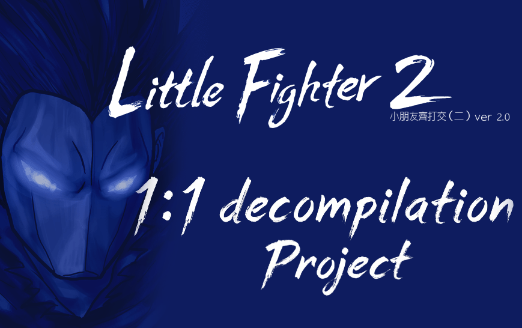
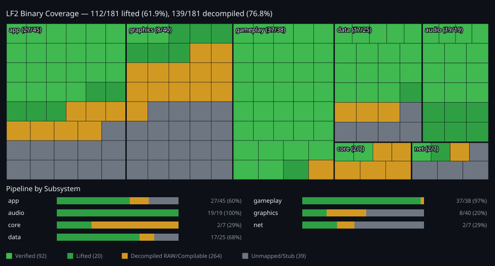

<div align="center">



# Little Fighter 2 | Binary Reverse Engineering, Decompilation & Source Lift

Forensic decompilation and modern C++20 / SDL2 source lift of the original *Little Fighter 2* (`lf2.exe`, v1.9c / v2.0a, x86-32 MSVC++). Preserves authentic frame timings, hitbox mathematics, deterministic PRNG tables, and `.lfr` / lockstep protocols while shedding Win32 and DirectDraw 6 dependencies.

[Conventions](docs/CONVENTIONS.md) · [Progress Rules](docs/PROGRESS.md) · [Parity Testing](docs/PARITY_TESTING.md) · [Interactive Dashboard](https://0xd34db8.github.io/LF2-decomp/progress.html)

</div>

---

## Status & Coverage

<!-- PROGRESS:START -->
[](https://0xd34db8.github.io/LF2-decomp/progress.html) [](https://0xd34db8.github.io/LF2-decomp/progress.html) [](https://0xd34db8.github.io/LF2-decomp/progress.html)

[](https://0xd34db8.github.io/LF2-decomp/progress.html)

[Interactive Dashboard](https://0xd34db8.github.io/LF2-decomp/progress.html) | [Daily Progress History](https://0xd34db8.github.io/LF2-decomp/history.html) | [Counting Rules](docs/PROGRESS.md)

| Subsystem | Total | RAW | Compilable | Lifted | Verified | Progress |
| :--- | ---: | ---: | ---: | ---: | ---: | ---: |
| `app` | 45 | 45 | 32 | 27 | 22 | 60.0% |
| `audio` | 19 | 19 | 19 | 19 | 13 | 100.0% |
| `core` | 8 | 8 | 4 | 2 | 2 | 25.0% |
| `data` | 25 | 25 | 19 | 17 | 16 | 68.0% |
| `gameplay` | 38 | 38 | 37 | 37 | 36 | 97.4% |
| `graphics` | 40 | 40 | 9 | 8 | 2 | 20.0% |
| `net` | 8 | 8 | 3 | 2 | 1 | 25.0% |
| **Total** | **183** | **183** | **123** | **112** | **92** | **61.2%** |

<sub>Game-code denominator: `183` verified `.text` procedures (`37` static `zlib 1.1.4` functions and `24` Win32 import thunks excluded).</sub>
<!-- PROGRESS:END -->

---

## Repository Architecture

```text
.
├── .github/workflows/          # CI (Windows MSYS2 + Linux checks), PR delta report, and Pages deploy
├── assets/
│   ├── hero.png                # Repository banner
│   └── progress/               # Auto-generated progress.svg coverage map and flat status badges
├── decompiled/
│   ├── functions.csv           # Canonical 244-entry .text inventory (183 game, 37 zlib, 24 thunks)
│   ├── RAW/                    # 185 immutable Ghidra .c exports across 7 subsystems
│   ├── Compilable/             # 55 compilable C translation units + test_legacy.c + Makefile
│   ├── resources/              # Extracted PE icon, manifest, and 64 embedded UI bitmaps
│   ├── verify_raw_entries.py   # Validates RAW filenames and functions.csv against VERIFIED_ENTRIES
│   └── README.md               # Decompiled suite overview
├── docs/
│   ├── CONVENTIONS.md          # Annotation grammar, inventory sync, and verification contract
│   ├── PROGRESS.md             # Counting rules, exclusions, treemap colors, and CLI commands
│   └── PARITY_TESTING.md       # Headless verification and deterministic .lfr replay parity design
├── lifted/
│   ├── src/                    # Modernized C++20 / SDL2 engine across 7 subsystems
│   ├── tests/                  # 16 standalone unit & parity test suites
│   ├── tools/                  # Embedded UI generation pipeline (generate_embedded_ui.py)
│   ├── third_party/            # Bundled MinGW-w64 SDL2 development headers and libraries
│   └── Makefile                # Build & test targets for liblf2.a, lf2.exe, and all 16 test suites
├── tools/
│   ├── progress.py             # Progress engine, annotation linter, SVG generator, and --next finder
│   ├── progress_history.py     # Daily first-parent Git history chart and HTML report generator
│   └── tests/test_progress.py  # Zero-dependency unit tests for progress tooling
├── AGENTS.md                   # Coding agent directives and verification contract
└── README.md                   # Repository overview (this file)
```

---

## Building & Verification

### Prerequisites
- **Windows Toolchain:** MSYS2 UCRT64 (`gcc` / `g++` 13+, `mingw32-make`, `zlib`)
- **Python:** Python 3.10+ (standard library only, zero `pip` dependencies)
- **SDL2:** Self-contained MinGW-w64 SDL2 headers and libraries in [`lifted/third_party/SDL2/`](lifted/third_party/SDL2/) (with `SDL2.dll` copied automatically on build)

### Commands

```powershell
# 1. Verify RAW exports, functions.csv schema/sync, source annotations, and README sync
python decompiled/verify_raw_entries.py
python tools/progress.py --check --check-readme
python -m unittest discover -s tools/tests -v

# 2. Build and run the decompiled compilable legacy C test suite
mingw32-make -C decompiled/Compilable test

# 3. Build and run all 16 lifted unit suites + 30-frame headless SDL2 smoke test (17 checks)
$env:SDL_VIDEODRIVER="dummy"; $env:SDL_AUDIODRIVER="dummy"; mingw32-make -C lifted test

# 4. Find the next highest-priority functions to decompile or lift
python tools/progress.py --next 15
```

In bash / MSYS2 / GitHub Actions:
```bash
SDL_VIDEODRIVER=dummy SDL_AUDIODRIVER=dummy mingw32-make -C lifted test
```

### Setting Up Authentic Game Assets
Because *Little Fighter 2* artwork, character sprites, sound effects, and stage backgrounds are proprietary freeware created by Marti Wong and Starsky Wong, they are not distributed in this repository. All unit tests, `test_legacy.exe`, and `lf2.exe --test --frames 30` run without external game assets.

To run the full interactive game:
1. Obtain an authentic *Little Fighter 2* installation (v1.9c, v2.0, or v2.0a) from [lf2.net](https://lf2.net) or [LF-Empire](https://lf-empire.de).
2. Copy `data/`, `sprite/`, `bg/`, `sound/`, and `bgm/` into `lifted/build/`, then run `.\lifted\build\lf2.exe` (`--fullscreen` optional; `Alt + Enter` toggles fullscreen).

---

## Data Structure Memory Maps

All memory structures match the exact byte layouts of the original MSVC++ 32-bit compilation target, verified via `static_assert` and unit test suites:

| Structure | Size (Hex) | Size (Bytes) | Description |
| :--- | :--- | :--- | :--- |
| [`bdy_t`](decompiled/Compilable/include/legacy_types.h) | `0x28` | 40 | Bounding box / physical collision boundary |
| [`itr_t`](decompiled/Compilable/include/legacy_types.h) | `0x50` | 80 | Interaction zone / attack hitbox / throw / catch |
| [`opoint_t`](decompiled/Compilable/include/legacy_types.h) | `0x20` | 32 | Projectile / weapon / particle spawn coordinate |
| [`bpoint_t`](decompiled/Compilable/include/legacy_types.h) | `0x0C` | 12 | Damage blood / impact particle coordinate |
| [`cpoint_t`](decompiled/Compilable/include/legacy_types.h) | `0x44` | 68 | Catch & throw interaction point |
| [`wpoint_t`](decompiled/Compilable/include/legacy_types.h) | `0x24` | 36 | Weapon attachment & holding position |
| [`frame_t`](decompiled/Compilable/include/legacy_types.h) | `0x178` | 376 | Animation frame state machine & hitbox arrays |
| [`file_t`](decompiled/Compilable/include/legacy_types.h) | `0x25360` | 152,416 | Character / weapon definition file (400 frames) |
| [`object_t`](decompiled/Compilable/include/legacy_types.h) | `0x420` | 1,056 | Monolithic entity instance in game world |
| [`global_t`](decompiled/Compilable/include/legacy_types.h) | `0x8D8`* | 2,264* | World manager (`0x458B00` static address) |

*\* Note: On 64-bit targets, pointers expand to 8 bytes, cleanly adjusting pointer table sizes in `global_t` without shifting fixed-offset member fields.*

---

<details>
<summary><h2 style="display:inline;">Prior Art vs. This Project</h2></summary>
<a id="prior-art-vs-this-project"></a>

Over the last two decades, the Little Fighter 2 community has attempted several ambitious projects to modernize or recreate the game. To understand our mission, it is vital to distinguish between modding, clean-room rewrites, and true binary reverse engineering:

### What Other Projects Did

| Community Approach | Methodology | Why It Differs |
| :--- | :--- | :--- |
| **External Scripting Rewrites** | Building a new engine from scratch and delegating gameplay logic to an external scripting engine (e.g. AngelScript), loosely inspired by original mechanics. | From-scratch recreation that abandons the original compiled execution flow, state transitions, and arithmetic quirks. |
| **Dynamic Memory Patching & DLL Hijacking** | Intercepting legacy graphics API calls via proxy wrappers (`ddraw.dll`) and injecting custom logic hooks directly into the closed-source process at runtime. | Dynamic memory modding. It still depends entirely on running the closed-source legacy executable in the background rather than freeing the source code. |
| **Clean-Room Interpretation Clones** | Rebuilding the engine from scratch using modern object-oriented software engineering principles and architectural design patterns. | While architecturally sound, it represents an interpretation of how the game *should* work, rather than extracting how the shipped binary actually operates. |
| **Open-Source Engine Reimplementations** | Modern clean-room clones built with contemporary frameworks and libraries specifically to parse and load legacy `.dat` assets. | Approximates mechanics from the outside, but lacks authentic assembly state machines, deterministic random generators, and timing quirks. |
| **Manual Disassembly Archives** | Manually translating raw disassembly into intermediate scripting languages (e.g. Ruby) or partial C stubs function-by-function. | Massive forensic undertaking that historically stalled before completing a compilable, fully modernized game engine, leaving uncorrected offset errors. |

### This Project

1. **Extracting, Not Guessing:** We do not invent custom OOP hierarchies, we do not guess class offsets, and we do not write high-level approximations. We decompile the compiled x86-32 MSVC++ machine code directly from the original executable and reconstruct the authentic logic in readable, typed C and modern C++.
2. **Byte-Level Mathematical Fidelity:** Collision detection, axis-aligned bounding box projections, directional facing mirrors, velocity integrations, deterministic lookup tables, and frame state machines are mathematically identical to the original assembly.
3. **Dual-Track Workflow:**
   - **Forensic Decompilation ([`decompiled/`](decompiled/)):** Pristine Ghidra exports paired with a self-contained, human-readable, compilable C suite that preserves exact memory layouts and calling conventions.
   - **Modernized Source Lift ([`lifted/`](lifted/)):** Portable C++20 / SDL2 implementation shedding legacy DirectDraw 6 and Win32 dependencies while retaining 100% gameplay parity.

</details>

---

<details>
<summary><h2 style="display:inline;">Reverse-Engineered Secrets, Ciphers & Easter Eggs</h2></summary>
<a id="reverse-engineered-secrets-ciphers--easter-eggs"></a>

Ghidra decompilation and binary disassembly revealed several fascinating, historic internal mechanics and easter eggs embedded directly into the machine code of `lf2.exe`:

### 1. The Legendary Resource Decryption Key: `"SiuHungIsAGoodBearBecauseHeIsVeryGood"`
* **Memory Location:** Hardcoded in the `.rdata` section at virtual address `0x0044892c` (file offset `0x4792c`).
* **Origin & Fun Fact:** "Siu Hung" (小熊) is the Cantonese pseudonym of Marti Wong (黃小熊), co-creator of Little Fighter 2 alongside Starsky Wong. Translated from Cantonese, it means:
  > *"Little Bear is a good bear because he is very good."*
* **The Cipher Architecture:** LF2 encodes all game resources (`.dat` files) using a byte-wise additive/subtractive variant of the Vigenère cipher operating modulo 256.
* **The 123-Byte Header Trick:** Every `.dat` file begins with a 123-byte (`0x7B`) padding header. In `FUN_004148a0`, the decryptor steps through the key `(key_idx + 1) % 37` for each of the 123 dummy bytes before decrypting any payload data. Since `123 % 37 = 12`, payload decryption always begins at key index `12` (the character `'G'` in `"GoodBear..."`):
  $$\text{plaintext}[i] = (\text{ciphertext}[i] - \text{key}[k] + 256) \pmod{256}$$
* **Modding Community Nostalgia:** For over two decades, this hardcoded string has been celebrated among LF2 modders who reverse-engineered the binary to create data decrypters (e.g., *LF2 Data Changer*).

### 2. The Replay (.lfr) Secondary Obfuscation Cipher (`0x0043DD60` / `0x0044D7A0`)
* **Two-Layer Protection in LF2 v2.0:** While legacy versions saved raw frame records, Little Fighter 2 v2.0 introduced a dual compression and encryption pipeline in `0x0043DD60` to protect replay recordings (`.lfr` files in `recording/`) from tampering and desynchronization.
* **zlib Deflation:** The memory buffer containing all recorded battle input frames is first compressed using a statically linked build of `zlib 1.1.4` (`compress()` / `deflate()` at `0x0043F4B0`).
* **The Obfuscation Pass:** Immediately after deflation, the engine loops through the compressed payload byte-by-byte and applies an additive character cipher using a hardcoded 1,345-byte ASCII digit key stored in `.data` at `0x0044D7A0`:
  ```text
  Key = "15456611235456134545631153456894056897..." (1,345 bytes)
  ```
* **Transformation Formula:** Each of the first $\min(N, 1345)$ bytes of the compressed stream is transformed using its corresponding key digit:
  $$\text{byte}[i] = (\text{byte}[i] + (\text{key}[i] - \text{'0'})) \pmod{256}$$
* This custom secondary cipher explains why third-party replay editors from the LF2 1.9c era failed to open or parse replays generated by version 2.0.

### 3. Secret Cheat Code State Machines in WindowProc (`0x0043b3d0`)
The original window procedure maintains static state counters that detect sequential keystrokes typed anywhere in the application:
* **`"lf2.net"` (Roster Unlock):** Typing `L` -> `F` -> `2` -> `.` -> `N` -> `E` -> `T` increments state tracker `DAT_0045857c` and sets `DAT_00455471 = 'd'` (ASCII `0x64`). This unlocks Julian, Firzen, and LouisEX on the character selection screen along with other enemy characters, which are non-playable by default.
* **`"herofighter.com"` (Sequel Easter Egg):** Typing `H` -> `E` -> `R` -> `O` -> `F` -> `I` -> `G` -> `H` -> `T` -> `E` -> `R` -> `.` -> `C` -> `O` -> `M` advances tracker `DAT_00458578` and sets `DAT_00455470 = 'd'`. Marti Wong embedded this secret domain name in later versions of LF2 as a nod to his next major project, *Hero Fighter*! It unlocks function keys (`F6`–`F9`) in Stage mode (they are active by default in VS mode).
* **`"ABC"` (Internal Data Debugger):** In `FUN_0043e9a0`, pressing `A` -> `B` -> `C` sequentially sets `DAT_00450bec = 1`, unlocking mode switching via keys `'1'`, `'2'`, `'3'` to access the built-in frame/weapon inspector mode.

### 4. Window & Platform Identity Artifacts
* **Window Class Name:** The Win32 window class is registered as `"Marti"` at `0x00447634`.
* **Window Title:** Defined as `"Little Fighter 2"` at `0x00447620`.
* **Authentic Viewport Resolution:** Hardcoded in the `.data` segment at `DAT_0044d78c` (width = `794`) and `DAT_0044d790` (height = `550`).

### 5. Deterministic Multiplayer PRNG Table
* Standard C library `rand()` implementations vary across compiler runtimes, which would desynchronize peer-to-peer multiplayer.
* LF2 completely avoids `rand()` during gameplay: at `0x0044FF90` in `.data`, it embeds a static, precomputed 3,000-byte pseudo-random table.
* The PRNG routine (`0x00417170`) simply advances a circular index:
  $$\text{index} = (\text{index} + 1) \pmod{3000}$$
  guaranteeing 100% deterministic lockstep synchronization across network clients.

### 6. Fixed-Step 30 FPS Timing & Spiral-of-Death Protection (`0x0043cf40`)
* **Tick Step:** In battle (`DAT_0044d02c != 0`), the step is `33 ms` (`0x21`), yielding ~30.3 FPS. In menus, it steps at `3 ms`.
* **Spiral of Death Clamp:** If system lag causes the accumulator to fall behind by more than `100 ms`, the game drops excess accumulated time:
  $$\text{if } (t[\text{now}] - t[\text{last}] > 100\text{ ms}) \implies t[\text{last}] = t[\text{now}] - 100\text{ ms}$$
* **CPU Yielding:** To prevent 100% CPU core starvation, the timing loop yields via sleep in chunks of at most `5 ms`.
* **Key State Table:** A raw 256-byte static array at `0x00455378` is initialized to `'u'` (`0x75` = up) in `WinMain` and toggled to `'d'` (`0x64` = down) on `WM_KEYDOWN`.

</details>

---

<details>
<summary><h2 style="display:inline;">Engine Quirks, Desyncs & Known Binary Bugs</h2></summary>
<a id="engine-quirks-desyncs--known-binary-bugs"></a>

Through Ghidra decompilation and binary disassembly of `lf2.exe`, we reverse-engineered the exact root causes of legendary Little Fighter 2 engine quirks, multiplayer desync crashes, and long-standing community mysteries:

### 1. The Anatomy of the Infamous "Synchronisation Error!" (`0x0041CAD9` / `0x0041CCB5`)
For over two decades, Little Fighter 2 players experienced sudden match freezes with a `"Synchronisation Error!"` modal dialog. Disassembly of the lockstep network routine in `0x0041C5F0` revealed the exact mechanism:
* **The 22-Byte Lockstep Packet:** At `0x0041C5F0`–`0x0041CB80`, every input exchange transmits a compact 22-byte packet containing 8 packed player controller states (`Up 0x80`, `Down 0x40`, `Left 0x20`, `Right 0x10`, `Attack 0x08`, `Jump 0x04`, `Defend 0x02`, base `0x01` idle bit), frame sequence counter, function-key & cheat flags (`+10`, `+12`), version byte, active HP checksum, and `.dat` file CRC.
* **Four-Tier Desynchronization Checks:** Disassembly at `0x0041CB50`–`0x0041CCD0` reveals the exact packet validation checks:
  * **Offset `+9` (Sequence Counter):** Frame counter modulo 50 (`DAT_00450bf0`). Checked at `0x0041CC27`; a mismatch halts with `"Connection Lost!"`.
  * **Offset `+11` (Version Tag):** Game version byte (`DAT_0044d03c`). Checked at `0x0041CC78`; a mismatch halts with `"Version not matched!"`.
  * **Offset `+13` (HP Checksum):** Cumulative 20-slot active character HP checksum (`(hp_sum % 100) + 1`, `DAT_00450bf4`). Checked at `0x0041CCB5`; if remote and local checksums differ by even 1 HP, execution halts with `"Synchronisation Error!"`.
  * **Offsets `+14..+15` (Data File CRC):** 16-bit split checksum derived from `DAT_0044f620`. Checked at `0x0041CCCE`; a mismatch halts with `"Data Error! You and your opponent have different set of data files."`.
* **The 3-Step Handshake Pipeline:**
  * **Step 1 (14 Bytes):** Host transmits `"u can connect\0"` (hardcoded at `0x00448900`).
  * **Step 2 (77 Bytes):** Slot negotiation (`"11110000"` host slots 1–4 vs `"00001111"` client slots 5–8) + four 10-byte player name strings delimited with `_`.
  * **Step 3 (3,001 Bytes):** 1-byte command tag + 3,000-byte precomputed circular PRNG table (`0x0044FF90`) so both peers share identical pseudo-random sequences.

### 2. The 400-Slot World Object Array & Screen Overflow Crash (`0x0042E100` / `0x004061D0`)
* **Static Allocation Ceiling:** Little Fighter 2 manages all entities on screen through a fixed global array in `global_t` (`0x00458B00`) capped at exactly **400 object slots** (`objects[400]` at offset `0x194`–`0x7D4`, matching `is_object_exists[400]` at `0x004`–`0x194`).
* **Shared Pool Competition:** Player characters (slots 0–7), enemy minions, dropped weapons (knives, baseball bats, rocks), projectiles (energy balls, ice swords), and transient particle effects (blood splatters, smoke puffs) all compete for these 400 slots. In `object_t`, the victim rest array `vrest_of_objects` is also exactly **400 bytes** (`0x0F0`–`0x280`).
* **The Crash Mechanism:** In heavy Stage Mode battles (e.g. Stage 5 with dozens of bandits or Firzen/LouisEX casting large multi-part special moves), the object spawner at `0x0042E100` scans the 400 slots looking for a free slot (`is_object_exists[i] == 0`). If all 400 slots are exhausted, newly spawned projectiles or weapon drops fail silently or return a null pointer that subsequent rendering and physics passes attempt to dereference, triggering an instant Crash-to-Desktop (CTD).

### 3. Player Name Grave Accent Substitution in `control.txt` (`0x004233E0` / `0x0042353A`)
* **The Parser Whitespace Dilemma:** In `data/control.txt`, player profiles, 11 keyboard mapping scan codes per player, and custom player names are serialized via standard C runtime `fscanf` / `fprintf`. Because `fscanf("%s")` delimits tokens on whitespace, any player name containing spaces (e.g. `"Little Bear"`) would corrupt line parsing.
* **The Clever Workaround:** At `0x004233E0`, Marti Wong implemented a character substitution loop that replaces every space (`' '`, ASCII `0x20`) with a grave accent character (`` '`' ``, ASCII `0x60`) before writing to disk:
  ```text
  Little`Bear Starsky`Wong Davis`Master Freeze`Knight
  ```
* At `0x0042353A`, during game boot, the parser reads the string and converts every `` '`' `` back to a space (`' '`). Players who opened `control.txt` in Notepad over the years often wondered why mysterious backticks appeared in their usernames!

### 4. Deterministic Battle Replay Recording (`.lfr` at `0x00429730` / `0x004028A0` / `0x0043DB40`)
* **100% Deterministic Playback:** Rather than saving full video or large coordinate streams, LF2 v2.0 replays (`.lfr` files) pack the initial 3,000-byte circular PRNG table seed (`0x0044D024`), character choices, periodic 150-frame cumulative HP checksums (`+0x14B8`), and **10-byte per-frame records** (`8` player controller bytes + function-key flags `+8` + cheat-unlock flags `+9`) into a `0x630E18`-byte compressed stream.
* **On-Screen HUD Indicators:** At `0x004028A0` (interior `0x00402980`), the engine uses DirectDraw to render color-coded notification banners at the bottom of the viewport ($y = 531$ / `0x213`):
  * **Orange (`0x00FF7800`):** `"Start recording '%s'..."` upon match commencement.
  * **Green (`0x0000FF00`):** `"Recording file '%s' saved!"` upon successful match conclusion.
  * **Red (`0x000000FF`):** `"Recording canceled!"` if the match is aborted prematurely.

</details>

---

<details>
<summary><h2 style="display:inline;">References & Acknowledgments</h2></summary>
<a id="references--acknowledgments"></a>

This source project builds upon the foundation of knowledge created by decades of dedicated Little Fighter 2 community developers and reverse engineers:

- **Marti Wong & Starsky Wong:** The original creators of *Little Fighter 2* (1999–2002). Their iconic beat-'em-up engine, fluid sprite animations, and brilliant emergent combat design remain unmatched.
- **xsoameix ([`xsoameix/lf2`](https://github.com/xsoameix/lf2) and [`xsoameix/openlf2`](https://github.com/xsoameix/openlf2)):** The true pioneer of LF2 decompilation. Over twelve years ago, `xsoameix` took on the monumental task of manually disassembling `lf2.exe` function-by-function into Ruby, decoded complex compiler-optimized arithmetic (such as integer division via magic multiplication constants), and drafted the initial C struct layouts. This work serves as our indispensable "Rosetta Stone".
- **Mesujin ([`LF2-Enchanted-4th`](https://github.com/Mesujin/LF2-Enchanted-4th), [`LF2-Modified_DDraw`](https://github.com/Mesujin/LF2-Modified_DDraw)):** For pioneering research into DirectDraw hook wrappers and modernizing LF2 runtime scripting.
- **Ori Vered ([`Little-Fighter-2---Rebuild`](https://github.com/OriVered/Little-Fighter-2---Rebuild)):** For clean-room architectural analysis and modern OOP reconstruction of LF2 combat mechanics.
- **OpenLF2 Team ([`OpenLF2/OpenLF2`](https://github.com/OpenLF2/OpenLF2)):** For exploring cross-platform engine architecture and modern SDL integration.
- **LF2 Empire & The Modding Community:** For decades of comprehensive documentation regarding character `.dat` scripting, interaction tags (`itr`, `bdy`, `wpoint`), and sprite mechanics.
- **NSA Ghidra:** For providing modern, high-fidelity headless disassembly, decompilation, and reverse engineering instrumentation.

</details>
