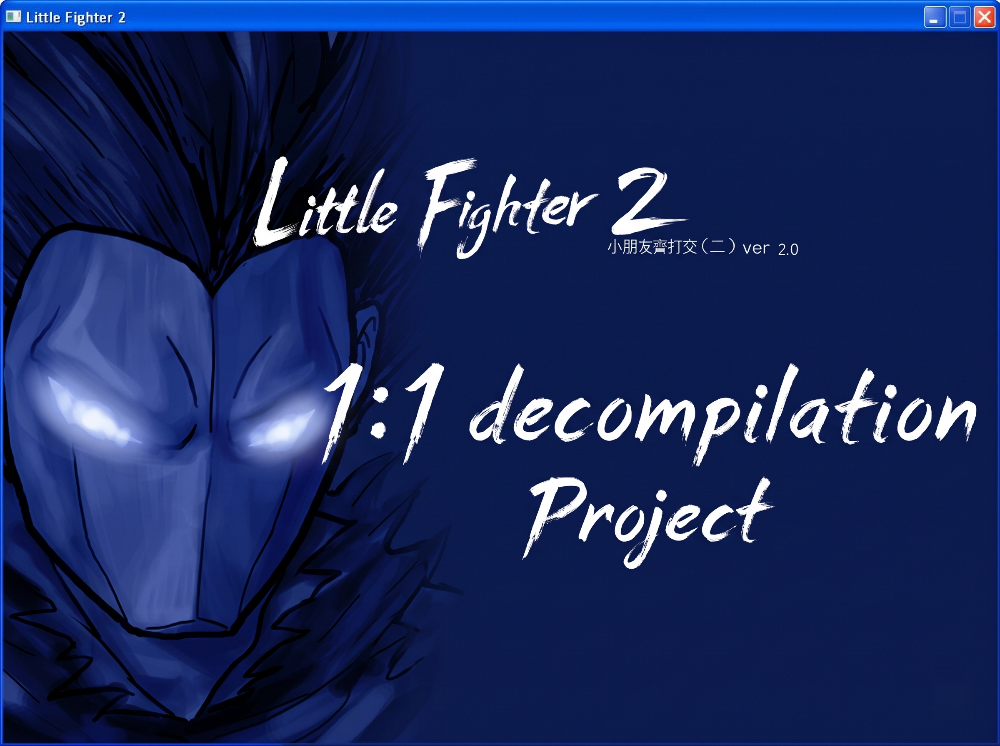

<div align="center">



# Little Fighter 2 | Binary Reverse Engineering, Decompilation & Source Lift

A complete binary reverse engineering, forensic decompilation, and modern C++ source lift of the original *Little Fighter 2* (`lf2.exe`, versions 1.9c / 2.0a, x86-32 MSVC++).

</div>

<div align="center">
This project is a systems programming and binary reverse engineering exercise designed to extract, lift, and preserve the authentic game logic (state machines, frame-accurate timings, hitbox collision mathematics, and data-driven file loading) while shedding legacy DirectDraw 6 and Win32 dependencies in favor of a modern cross-platform architecture.
</div>

---

## Project Scope

The primary objective of this repository is the complete reverse engineering and forensic decompilation of the original closed-source x86-32 MSVC++ executable (`lf2.exe`). By combining **NSA Ghidra** & historical assembly mapping, this project recovers the authentic, byte-accurate algorithms, memory structures, and mathematical logic written by Marti Wong and Starsky Wong between 1999 and 2002.

As a companion system, the repository also tries to provide a modernized **C++20 / SDL2 Source Lift** in [`lifted/`](lifted/), freeing the game from deprecated 1990s Win32 and DirectDraw 6 dependencies.

---

<details>
<summary><h2 style="display:inline;">Repository Architecture</h2></summary>
<a id="repository-architecture"></a>

The workspace is organized into dedicated, self-contained sub-environments to ensure complete isolation between forensic evidence, compilable legacy code, modern engine code, and project documentation:

```text
LF2/
├── assets/                     # Media documentation assets & hero banners
├── decompiled/                 # Primary Reverse Engineering Archive
│   ├── RAW/                    # Pristine decompiler outputs directly from Ghidra
│   │   ├── app/                # Raw WinMain, WndProc, menu & tournament state machines
│   │   ├── audio/              # Raw DirectSound & WAV buffer loaders
│   │   ├── core/               # Raw PRNG table & coordinate math
│   │   ├── data/               # Raw .dat lexers, cipher decryption & control.txt parsers
│   │   ├── gameplay/           # Raw combat dispatcher, hitboxes, AI & weapon attachment
│   │   ├── graphics/           # Raw DirectDraw blitters, clipping & parallax math
│   │   └── net/                # Raw lockstep network exchange & packet verifiers
│   ├── Compilable/             # Self-contained, compilable legacy C suite (48 translation units, 59 routines)
│   │   ├── include/            # legacy_types.h (typed structs), legacy_signatures.h, legacy_globals.h
│   │   ├── app/                # Clean C routines: winmain.c, wndproc.c, battle_mode.c, etc.
│   │   ├── audio/              # Clean C routines: sound_init.c, sound_load_wav.c, sound_play.c, bgm_manager.c
│   │   ├── core/               # Clean C routines: abs.c, random.c, overlap.c, legacy_globals.c
│   │   ├── data/               # Clean C routines: load_dat.c, save_dat.c, decrypt_dat.c, etc.
│   │   ├── gameplay/           # Clean C routines: attack_process.c, teleport.c, ai_process.c, etc.
│   │   ├── graphics/           # Clean C routines: draw_object.c, parallax_calc.c, clip_rect.c, etc.
│   │   ├── net/                # Clean C routines: net_init.c, net_lockstep.c
│   │   ├── Makefile            # Dedicated build system for compilable legacy archive
│   │   ├── test_legacy.c       # Verification suite for data layout & decompiled math parity
│   │   └── README.md           # Documentation, memory mapping & type registries
│   ├── resources/              # Embedded PE resources extracted directly from lf2.exe
│   │   ├── icon/               # Authentic 32x32 application icon (lf2.ico)
│   │   ├── manifest/           # Original MSVC 8.0 CRT & MFC assembly dependency manifest
│   │   └── ui/                 # 64 bitmap interface images extracted from RT_BITMAP
│   └── README.md               # Master decompiled function registry & Ghidra address index
├── lifted/                     # Dedicated Modern C++20 / SDL2 Source Lift
│   ├── src/                    # Modernized game engine code
│   │   ├── app/                # SDL2 windowing, event pump, scene transitions, fixed 30 FPS pacing
│   │   ├── audio/              # DirectSound & DirectShow replacement via SDL2 audio pipeline, mixer & BGM streamer
│   │   ├── core/               # Domain structures, deterministic PRNG, replay pipeline
│   │   ├── data/               # Lexer, Vigenère cipher decrypter & control configuration parser
│   │   ├── gameplay/           # Combat dispatcher, hitbox intersection, entity physics & AI
│   │   ├── graphics/           # SDL2 software renderer, parallax background & embedded UI
│   │   └── net/                # Modern lockstep network sync & packet serialization
│   ├── data/                   # UI source bitmaps & default control.txt configurations
│   ├── tests/                  # 15 comprehensive unit test suites
│   ├── tools/                  # Embedded UI generation pipeline (generate_embedded_ui.py)
│   ├── third_party/            # Self-contained MinGW-w64 SDL2 development headers & libraries
│   ├── Makefile                # Independent build system for the lifted engine
│   └── README.md               # Documentation for the modern source lift
├── AGENTS.md                   # Pair programming directives & architectural rules
├── REFERENCE_ERRORS.md         # Reference error catalog of past community decompilations
├── .gitignore                  # Git ignore rules
└── README.md                   # Master repository documentation (this file)
```

</details>

---

<details>
<summary><h2 style="display:inline;">Prior Art vs. This Project</h2></summary>
<a id="prior-art-vs-this-project"></a>

Over the last two decades, the Little Fighter 2 community has attempted several ambitious projects to modernize or recreate the game. To understand our mission, it is vital to distinguish between modding, clean-room rewrites, and true binary reverse engineering:

### What Other Projects Did

| Community Approach | Methodology | Why It Differs |
| :--- | :--- | :--- |
| **External Scripting Rewrites** | Building a new engine from scratch and delegating gameplay logic to an external scripting engine (e.g. AngelScript), loosely inspired by original mechanics. | From-scratch recreation that abandons the original compiled execution flow, state transitions, and arithmetic quirks. |
| **Dynamic Memory Patching & DLL Hijacking** | Intercepting legacy graphics API calls via proxy wrappers (`ddraw.dll`) and injecting custom logic hooks directly into the closed-source process at runtime. | Dynamic memory modding. It still depends entirely on running the closed-source legacy executable in the background rather than freeing the source code. |
| **Clean-Room Interpretation Clones** | Rebuilding the engine from scratch using modern object-oriented software engineering principles and architectural design patterns. | While architecturally sound, it represents an interpretation of how the game *should* work, rather than extracting how the shipped binary actually operates. |
| **Open-Source Engine Reimplementations** | Modern clean-room clones built with contemporary frameworks and libraries specifically to parse and load legacy `.dat` assets. | Approximates mechanics from the outside, but lacks authentic assembly state machines, deterministic random generators, and timing quirks. |
| **Manual Disassembly Archives** | Manually translating raw disassembly into intermediate scripting languages (e.g. Ruby) or partial C stubs function-by-function. | Massive forensic undertaking that historically stalled before completing a compilable, fully modernized game engine, leaving uncorrected offset errors. |

### This Project

1. **Extracting, Not Guessing:** We do not invent custom OOP hierarchies, we do not guess class offsets, and we do not write high-level approximations. We decompile the compiled x86-32 MSVC++ machine code directly from the original executable and reconstruct the authentic logic in readable, typed C and modern C++.
2. **Byte-Level Mathematical Fidelity:** Collision detection, axis-aligned bounding box projections, directional facing mirrors, velocity integrations, deterministic lookup tables, and frame state machines are mathematically identical to the original assembly.
3. **Dual-Track Workflow:**
   - **Forensic Decompilation ([`decompiled/`](decompiled/)):** Pristine Ghidra exports paired with a self-contained, human-readable, compilable C suite that preserves exact memory layouts and calling conventions.
   - **Modernized Source Lift ([`lifted/`](lifted/)):** Portable C++20 / SDL2 implementation shedding legacy DirectDraw 6 and Win32 dependencies while retaining 100% gameplay parity.

</details>

---

<details>
<summary><h2 style="display:inline;">Core Directives & Verification Standards</h2></summary>
<a id="core-directives--verification"></a>

1. **Never Guess Offsets:** Every struct size and member variable offset is verified against Ghidra decompiler pseudocode and backed by compile-time `static_assert` statements.
2. **Strict Adherence to Math:** Floating-point velocity integrations, hitbox coordinates, and frame timers are mathematically identical to the original x86 disassembly.
3. **Dual-Target Portability:** Pointers and struct layouts are designed to maintain byte-offset parity on 32-bit compilation targets while running without memory truncation or segmentation faults on modern 64-bit systems.

</details>

---

<details>
<summary><h2 style="display:inline;">Data Structure Memory Maps</h2></summary>
<a id="data-structure-memory-maps"></a>

All memory structures match the exact byte layouts of the original MSVC++ 32-bit compilation target, verified via `static_assert` and unit test suites:

| Structure | Size (Hex) | Size (Bytes) | Description |
| :--- | :--- | :--- | :--- |
| [`bdy_t`](decompiled/Compilable/include/legacy_types.h) | `0x28` | 40 | Bounding box / physical collision boundary |
| [`itr_t`](decompiled/Compilable/include/legacy_types.h) | `0x50` | 80 | Interaction zone / attack hitbox / throw / catch |
| [`opoint_t`](decompiled/Compilable/include/legacy_types.h) | `0x20` | 32 | Projectile / weapon / particle spawn coordinate |
| [`bpoint_t`](decompiled/Compilable/include/legacy_types.h) | `0x0C` | 12 | Damage blood / impact particle coordinate |
| [`cpoint_t`](decompiled/Compilable/include/legacy_types.h) | `0x44` | 68 | Catch & throw interaction point |
| [`wpoint_t`](decompiled/Compilable/include/legacy_types.h) | `0x24` | 36 | Weapon attachment & holding position |
| [`frame_t`](decompiled/Compilable/include/legacy_types.h) | `0x178` | 376 | Animation frame state machine & hitbox arrays |
| [`file_t`](decompiled/Compilable/include/legacy_types.h) | `0x25360` | 152,416 | Character / weapon definition file (400 frames) |
| [`object_t`](decompiled/Compilable/include/legacy_types.h) | `0x370` | 880 | Monolithic entity instance in game world |
| [`global_t`](decompiled/Compilable/include/legacy_types.h) | `0x8D8`* | 2,264* | World manager (`0x458B00` static address) |

*\* Note: On 64-bit targets, pointers expand to 8 bytes, cleanly adjusting pointer table sizes in `global_t` without shifting fixed-offset member fields.*

</details>

---

<details>
<summary><h2 style="display:inline;">Building & Verification</h2></summary>
<a id="building--verification"></a>

### Prerequisites
- **Compiler:** Modern C/C++ toolchain (GCC 13+ / MSYS2 UCRT64 GCC 14.2+ / Clang 15+)
- **Build Tool:** GNU `make` or `mingw32-make`
- **SDL2:** MinGW-w64 development libraries are self-contained in [`lifted/third_party/SDL2/`](lifted/third_party/SDL2/), with `SDL2.dll` provided for runtime execution.

---

### 1. Compilable Decompiled Legacy Suite (`decompiled/Compilable/`)

Because *Little Fighter 2* artwork, sprite sheets, sound effects, and stage backgrounds are proprietary freeware created by Marti Wong and Starsky Wong, they are not distributed in this source code repository.

```bash
# Build the legacy static library (decompiled/Compilable/build/liblf2_legacy.a)
mingw32-make -C decompiled/Compilable

# Run the decompiled verification test suite
mingw32-make -C decompiled/Compilable test

# Clean legacy build artifacts
mingw32-make -C decompiled/Compilable clean
```

**Verification Suite (`test_legacy.exe`) checks:**
- 1:1 Fast integer absolute value computation (`0x004034e0`)
- 2D Bounding box overlap arithmetic (`0x004171c0`)
- Deterministic 3,000-byte circular PRNG table lookup (`0x00417170`)
- Exact `sizeof` and `offsetof` alignments for all 10 domain structures
- Rudolf teleportation gameplay positioning logic (`0x00403270`)

---

### 2. Modernized Source Lift Engine (`lifted/`)

The modernized source lift builds an independent executable and static engine library:

```bash
# Build the modernized game executable (lifted/build/lf2.exe)
mingw32-make -C lifted

# Run all 14 unit test suites and the 30-frame verification test (15 tests total)
mingw32-make -C lifted test

# Clean lifted build artifacts
mingw32-make -C lifted clean
```

#### Running the Game:
```bash
# Launch from the lifted directory
cd lifted && ./build/lf2.exe

# Launch directly in fullscreen mode
cd lifted && ./build/lf2.exe --fullscreen
```

* **Controls & Player Mapping:** Player keys are configured via `control.txt`.
* **Fullscreen Toggle:** Press `Alt + Enter` to switch between windowed (794x550) and fullscreen.
* **Secret Cheat Codes:**
  - Type `lf2.net` on the main menu to unlock Julian, Firzen, LouisEX, and all enemy henchmen.
  - Type `herofighter.com` to enable stage debug function keys.
  - Type `ABC` to unlock the internal frame and hitbox inspector.

---

### 3. Setting Up Authentic Game Assets

Little Fighter 2 artwork, character sprites, sound effects, and stage backgrounds are proprietary freeware created by Marti Wong and Starsky Wong, and are not distributed in this repository.

To run the lifted engine with full audio and visual assets:
1. Obtain an authentic Little Fighter 2 installation (v1.9c, v2.0, or v2.0a) from [lf2.net](https://lf2.net) or [LF-Empire](https://lf-empire.de).
2. Copy the authentic game folders (`data/`, `sprite/`, `bg/`, `sound/`, `bgm/`) into `lifted/build/` (or run `lf2.exe` directly inside an existing LF2 directory).
3. All frontend menu and character selection UI images are pre-baked directly into the binary (`lifted/src/graphics/embedded_ui.cpp`), exactly mirroring the Win32 PE resource architecture of the original binary.

</details>

---

<details>
<summary><h2 style="display:inline;">Reverse-Engineered Secrets, Ciphers & Easter Eggs</h2></summary>
<a id="reverse-engineered-secrets-ciphers--easter-eggs"></a>

Ghidra decompilation and binary disassembly revealed several fascinating, historic internal mechanics and easter eggs embedded directly into the machine code of `lf2.exe`:

### 1. The Legendary Resource Decryption Key: `"SiuHungIsAGoodBearBecauseHeIsVeryGood"`
* **Memory Location:** Hardcoded in the `.rdata` section at virtual address `0x0044892c` (file offset `0x4792c`).
* **Origin & Fun Fact:** "Siu Hung" (小熊) is the Cantonese pseudonym of Marti Wong (黃小熊), co-creator of Little Fighter 2 alongside Starsky Wong. Translated from Cantonese, it means:
  > *"Little Bear is a good bear because he is very good."*
* **The Cipher Architecture:** LF2 encodes all game resources (`.dat` files) using a byte-wise additive/subtractive variant of the Vigenère cipher operating modulo 256.
* **The 123-Byte Header Trick:** Every `.dat` file begins with a 123-byte (`0x7B`) padding header. In `FUN_004148a0`, the decryptor steps through the key `(key_idx + 1) % 37` for each of the 123 dummy bytes before decrypting any payload data. Since `123 % 37 = 12`, payload decryption always begins at key index `12` (the character `'G'` in `"GoodBear..."`):
  $$\text{plaintext}[i] = (\text{ciphertext}[i] - \text{key}[k] + 256) \pmod{256}$$
* **Modding Community Nostalgia:** For over two decades, this hardcoded string has been celebrated among LF2 modders who reverse-engineered the binary to create data decrypters (e.g. *LF2 Data Changer*).

### 2. The Replay (.lfr) Secondary Obfuscation Cipher (`0x0043DD60` / `0x0044D7A0`)
* **Two-Layer Protection in LF2 v2.0:** While legacy versions saved raw frame records, Little Fighter 2 v2.0 introduced a dual compression and encryption pipeline in `0x0043DD60` to protect replay recordings (`.lfr` files in `recording\`) from tampering and desynchronization.
* **zlib Deflation:** The memory buffer containing all recorded battle input frames is first compressed using a statically linked build of `zlib 1.1.4` (`compress()` / `deflate()` at `0x0043F4B0`).
* **The Obfuscation Pass:** Immediately after deflation, the engine loops through the compressed payload byte-by-byte and applies an additive character cipher using a hardcoded 32-byte ASCII key string stored in `.data` at `0x0044D7A0`:
  ```text
  Key = "15456611235456134545631153456894"
  ```
* **Transformation Formula:** Each byte of the compressed stream is transformed via modular arithmetic relative to the key digits:
  $$\text{byte}[i] = (\text{byte}[i] + (\text{key}[i \pmod{32}] - \text{'0'})) \pmod{256}$$
* This custom secondary cipher explains why third-party replay editors from the LF2 1.9c era failed to open or parse replays generated by version 2.0.

### 3. Secret Cheat Code State Machines in WindowProc (`0x0043b3d0`)
The original window procedure maintains static state counters that detect sequential keystrokes typed anywhere in the application:
* **`"lf2.net"` (Roster Unlock):** Typing `L` -> `F` -> `2` -> `.` -> `N` -> `E` -> `T` increments state tracker `DAT_0045857c` and sets `DAT_00455471 = 'd'` (ASCII 0x64). This unlocks Julian, Firzen, and LouisEX on the character selection screen along with other enemy characters, which are non playable by default.
* **`"herofighter.com"` (Sequel Easter Egg):** Typing `H` -> `E` -> `R` -> `O` -> `F` -> `I` -> `G` -> `H` -> `T` -> `E` -> `R` -> `.` -> `C` -> `O` -> `M` advances tracker `DAT_00458578` and sets `DAT_00455470 = 'd'`. Marti Wong embedded this secret domain name in later versions of LF2 as a nod to his next major project, *Hero Fighter*! It enables the user to use function keys in the Stage mode of the game.
* **`"ABC"` (Internal Data Debugger):** In `FUN_0043e9a0`, pressing `A` -> `B` -> `C` sequentially sets `DAT_00450bec = 1`, unlocking mode switching via keys `'1'`, `'2'`, `'3'` to access the built-in frame/weapon inspector mode.

### 4. Window & Platform Identity Artifacts
* **Window Class Name:** The Win32 window class is registered as `"Marti"` at `0x00447634`.
* **Window Title:** Defined as `"Little Fighter 2"` at `0x00447620`.
* **Authentic Viewport Resolution:** Hardcoded in the `.data` segment at `DAT_0044d78c` (width = `794`) and `DAT_0044d790` (height = `550`).

### 5. Deterministic Multiplayer PRNG Table
* Standard C library `rand()` implementations vary across compiler runtimes, which would desynchronize peer-to-peer multiplayer.
* LF2 completely avoids `rand()` during gameplay: at `0x0044FF90` in `.data`, it embeds a static, precomputed 3,000-byte pseudo-random table.
* The PRNG routine (`0x00417170`) simply advances a circular index:
  $$\text{index} = (\text{index} + 1) \pmod{3000}$$
  guaranteeing 100% deterministic lockstep synchronization across network clients.

### 6. Fixed-Step 30 FPS Timing & Spiral-of-Death Protection (`0x0043cf40`)
* **Tick Step:** In battle (`DAT_0044d02c != 0`), the step is `33 ms` (`0x21`), yielding ~30.3 FPS. In menus, it steps at `3 ms`.
* **Spiral of Death Clamp:** If system lag causes the accumulator to fall behind by more than `100 ms`, the game drops excess accumulated time:
  $$\text{if } (t[\text{now}] - t[\text{last}] > 100\text{ ms}) \implies t[\text{last}] = t[\text{now}] - 100\text{ ms}$$
* **CPU Yielding:** To prevent 100% CPU core starvation, the timing loop yields via sleep in chunks of at most `5 ms`.
* **Key State Table:** A raw 256-byte static array at `0x00455378` is initialized to `'u'` (`0x75` = up) in `WinMain` and toggled to `'d'` (`0x64` = down) on `WM_KEYDOWN`.

</details>

---

<details>
<summary><h2 style="display:inline;">Engine Quirks, Desyncs & Known Binary Bugs</h2></summary>
<a id="engine-quirks-desyncs--known-binary-bugs"></a>

Through Ghidra decompilation and binary disassembly of `lf2.exe`, we reverse-engineered the exact root causes of legendary Little Fighter 2 engine quirks, multiplayer desync crashes, and long-standing community mysteries:

### 1. The Anatomy of the Infamous "Synchronisation Error!" (`0x0041CAD9` / `0x0041CCB5`)
For over two decades, Little Fighter 2 players experienced sudden match freezes with a `"Synchronisation Error!"` modal dialog. Disassembly of the lockstep network routine in `0x0041C5F0` revealed the exact mechanism:
* **The 22-Byte Lockstep Packet:** At `0x0041CB80`, every frame exchange transmits a compact 22-byte packet (`net_packet_t`) containing 8 packed player controller states (Up `0x02`, Right `0x04`, Attack `0x08`, Jump `0x10`, Defend `0x20`, Down `0x40`, Left `0x80`, with `0x01` idle bit), frame sequence counter, version byte, and active HP checksum.
* **Three-Tier Desynchronization Checks:** Disassembly at `0x0041CB50`–`0x0041CCD0` reveals the exact single-byte checks:
  * **Offset `+9` (Sequence Counter):** Frame counter modulo 50 (`idiv $0x32`, `DAT_00450bf0`). Checked at `0x0041CC27`; a mismatch halts with `"Connection Lost!"` (`0x004493B4`).
  * **Offset `+11` (Version Tag):** Game version byte (`DAT_0044d03c`). Checked at `0x0041CC78`; a mismatch halts with `"Version not matched!"` (`0x0044939C`).
  * **Offset `+13` (HP Checksum):** Cumulative active player HP checksum (`DAT_00450bf4`). Checked at `0x0041CCB5`; if remote and local checksums differ by even 1 HP, execution halts with `"Synchronisation Error!"` (`0x00449384`).
* **The 3-Phase Handshake Pipeline:**
  * **Phase 1 (14 Bytes):** Host transmits `"u can connect\0"` (hardcoded at `0x00448900`).
  * **Phase 2 (77 Bytes):** Slot negotiation (`"11110000"` host slots 1–4 vs `"00001111"` client slots 5–8) + four 10-byte player name strings delimited with `_`.
  * **Phase 3 (3,001 Bytes):** 1-byte command tag + 3,000-byte precomputed circular PRNG table (`0x0044FF90`) so both peers share identical pseudo-random sequences.

### 2. The 400-Slot World Object Array & Screen Overflow Crash (`0x0042E100` / `0x004061D0`)
* **Static Allocation Ceiling:** Little Fighter 2 manages all entities on screen through a fixed global array in `global_t` (`0x00458B00`) capped at exactly **400 object slots** (`objects[400]` at offset `0x194`–`0x7D4`, matching `is_object_exists[400]` at `0x004`–`0x194`).
* **Shared Pool Competition:** Player characters (slots 0–7), enemy minions, dropped weapons (knives, baseball bats, rocks), projectiles (energy balls, ice swords), and transient particle effects (blood splatters, smoke puffs) all compete for these 400 slots. In `object_t`, the victim rest array `vrest_of_objects` is also exactly **400 bytes** (`0x0F0`–`0x280`).
* **The Crash Mechanism:** In heavy Stage Mode battles (e.g. Stage 5 with dozens of bandits or Firzen/LouisEX casting large multi-part special moves), the object spawner at `0x0042E100` scans the 400 slots looking for a free slot (`is_object_exists[i] == 0`). If all 400 slots are exhausted, newly spawned projectiles or weapon drops fail silently or return a null pointer that subsequent rendering and physics passes attempt to dereference, triggering an instant Crash-to-Desktop (CTD).

### 3. Player Name Grave Accent Substitution in `control.txt` (`0x004233E0` / `0x0042353A`)
* **The Parser Whitespace Dilemma:** In `data/control.txt`, player profiles, 11 keyboard mapping scan codes per player, and custom player names are serialized via standard C runtime `fscanf` / `fprintf`. Because `fscanf("%s")` delimits tokens on whitespace, any player name containing spaces (e.g. `"Little Bear"`) would corrupt line parsing.
* **The Clever Workaround:** At `0x004233E0`, Marti Wong implemented a character substitution loop that replaces every space (`' '`, ASCII `0x20`) with a grave accent character (`` '`' ``, ASCII `0x60`) before writing to disk:
  ```text
  Little`Bear Starsky`Wong Davis`Master Freeze`Knight
  ```
* At `0x0042353A`, during game boot, the parser reads the string and converts every `` '`' `` back to a space (`' '`). Players who opened `control.txt` in Notepad over the years often wondered why mysterious backticks appeared in their usernames!

### 4. Deterministic Battle Replay Recording (`.lfr` at `0x00429730` / `0x004028A0`)
* **100% Deterministic Playback:** Rather than saving full video or large coordinate streams, LF2 replays (`.lfr` files) record only the initial 3,000-byte circular PRNG table seed (`0x0044D024`), character choices, and 8 bytes of packed controller input states per frame.
* **On-Screen HUD Indicators:** At `0x004028A0` (interior `0x00402980`), the engine uses DirectDraw to render color-coded notification banners at the bottom of the viewport ($y = 531$ / `0x213`):
  * **Orange (`0x00FF7800`):** `"Start recording '%s'..."` upon match commencement.
  * **Green (`0x0000FF00`):** `"Recording file '%s' saved!"` upon successful match conclusion.
  * **Red (`0x000000FF`):** `"Recording canceled!"` if the match is aborted prematurely.

</details>

---

<details>
<summary><h2 style="display:inline;">References & Acknowledgments</h2></summary>
<a id="references--acknowledgments"></a>

This source project builds upon the foundation of knowledge created by decades of dedicated Little Fighter 2 community developers and reverse engineers:

- **Marti Wong & Starsky Wong:** The original creators of *Little Fighter 2* (1999–2002). Their iconic beat-'em-up engine, fluid sprite animations, and brilliant emergent combat design remain unmatched.
- **xsoameix ([`xsoameix/lf2`](https://github.com/xsoameix/lf2) and [`xsoameix/openlf2`](https://github.com/xsoameix/openlf2)):** The true pioneer of LF2 decompilation. Over twelve years ago, `xsoameix` took on the monumental task of manually disassembling `lf2.exe` function-by-function into Ruby, decoded complex compiler-optimized arithmetic (such as integer division via magic multiplication constants), and drafted the initial C struct layouts. This work serves as our indispensable "Rosetta Stone".
- **Mesujin ([`LF2-Enchanted-4th`](https://github.com/Mesujin/LF2-Enchanted-4th), [`LF2-Modified_DDraw`](https://github.com/Mesujin/LF2-Modified_DDraw)):** For pioneering research into DirectDraw hook wrappers and modernizing LF2 runtime scripting.
- **Ori Vered ([`Little-Fighter-2---Rebuild`](https://github.com/OriVered/Little-Fighter-2---Rebuild)):** For clean-room architectural analysis and modern OOP reconstruction of LF2 combat mechanics.
- **OpenLF2 Team ([`OpenLF2/OpenLF2`](https://github.com/OpenLF2/OpenLF2)):** For exploring cross-platform engine architecture and modern SDL integration.
- **LF2 Empire & The Modding Community:** For decades of comprehensive documentation regarding character `.dat` scripting, interaction tags (`itr`, `bdy`, `wpoint`), and sprite mechanics.
- **NSA Ghidra:** For providing modern, high-fidelity headless disassembly, decompilation, and reverse engineering instrumentation.

</details>
